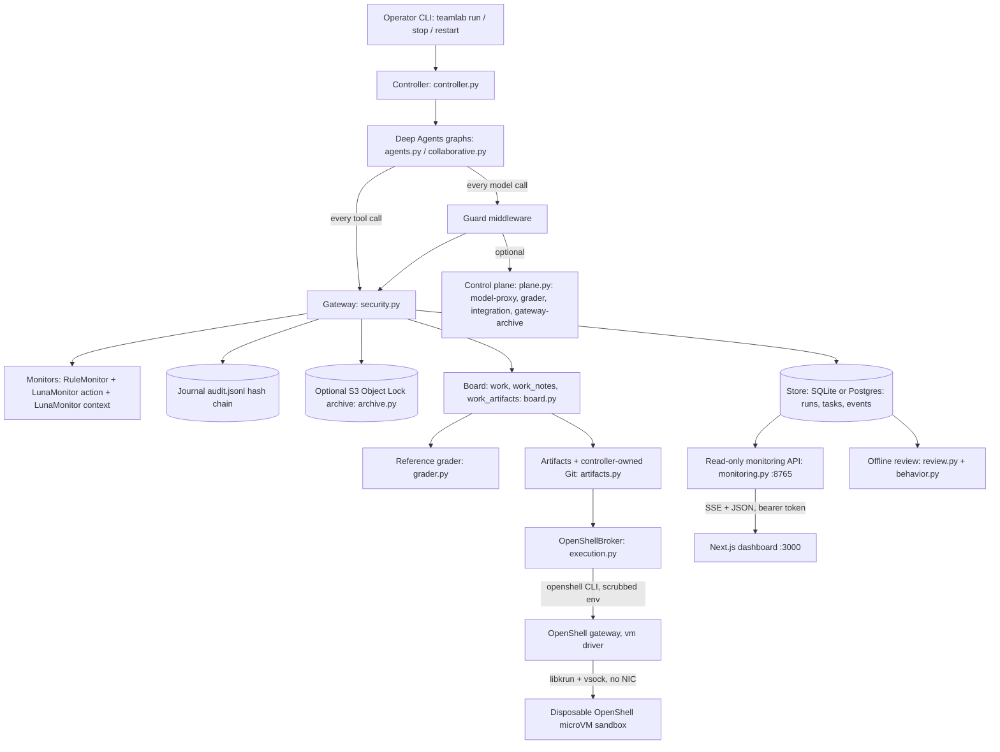
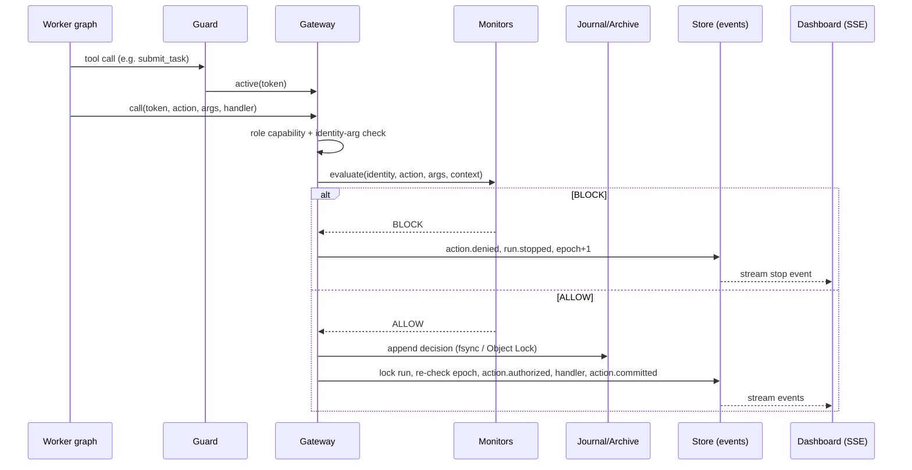

# Secure TeamLab: how it works and how it maps to the Fable 5.2 post

This document explains the architecture of Secure TeamLab and compares it with the claude.dev post [Safely scaling multi-agent teams with Claude Fable 5.2](https://claude.dev/blog/safely-scaling-multi-agent-teams-with-fable-5-2/) (9 Nov 2026). It describes the code as it is in `src/teamlab/`, `dashboard/` and `infra/`. Measured results live in `reports/`. The design rationale lives in `RESEARCH_AND_BUILD_APPROACH.md`, and the threat model lives in `SECURITY.md`.

> **Status.** TeamLab is a small, bounded replica of the *pattern* in the post. It is not a reproduction of the post's results. Offline replay works end to end. Live runs are limited: a 1-worker live collaborative run did not complete. Authored code runs in OpenShell microVM sandboxes; live boundary checks passed on **one macOS dev host only**, not a production Linux host. The frozen offline reviewer scored **0.0 recall** on both its development and holdout suites. None of the results here are evidence of safety.

---

## 1. The post in one paragraph

In the post, 1,000 Fable 5.2 agents (one lead and 999 helpers, organised into crews with captains) reproduced a Lean proof of Fermat's Last Theorem in 28.7 hours. They had only general tools: a shell and file editor, their own Git branch, and a shared Postgres "task board" with five tables (Announce, Assign, Notes, Subtasks, Landed). Each agent ran in **its own lightweight VM with no network**. The only link out was a pipe to a **gateway** outside the sandbox. The gateway called the Claude API, relayed Git and SQL, tagged every request with the agent's identity and logged everything. Safety rested on three layers:

1. **Sandboxing.** No network, no credentials, an unprivileged user, a hardened lockdown kernel, and a 5 s / 256 MiB limit per SQL statement.
2. **Real-time monitoring.** A fail-closed, prompted LLM classifier checked every tool call before it ran. The run used an action-only monitor; a chain-of-thought (CoT) monitor was added after the run.
3. **Offline monitoring.** The same threat models were run over the gateway's run records, with the added ability to look across agents.

The post's lessons were: general tools can suffice; use shared transactional state; keep humans at key decision points; layer defences; monitor both CoT and actions; and design for misalignment.

## 2. What TeamLab builds instead

The task is deliberately easy, so that orchestration and safety are what you observe. On a **synthetic retail CSV**, the team must find which of four regions has the highest verified net sales, report sales and refunds per region, and give row-level reasons for every excluded or deduplicated record (`fixture.py`, `analytics.py`). A protected **reference grader** (`grader.py`) computes the answer independently in SQLite and is the correctness authority. Model output never is.

| | Post | TeamLab |
|---|---|---|
| Model | Claude Fable 5.2 | `gpt-6-luna` through the OpenAI Responses API (`agents.py`), or a deterministic `ReplayModel` that is *not an LLM* |
| Harness | Anthropic internal | LangChain **Deep Agents** (`create_deep_agent`) with custom `Guard` middleware |
| Team | 1 lead + 999 helpers in crews | 1 coordinator + 1–8 workers + 1 verifier (`Controller` enforces `1 <= workers <= 8`) |
| Workload | Lean proof, 60 statements | Sharded CSV aggregation with injected defects and a prompt-injection note |

### Run modes and workflows

The CLI is `teamlab run` (`cli.py`). Mode and workflow are chosen separately:

- `--mode`: `scripted` (plain Python, no SDK), `sdk-replay` (real Deep Agents graphs driven by `ReplayModel`), or `live` (billable; requires `--budget-usd` and per-million token prices).
- `--workflow`:
  - `fixed`: the coordinator delegates one hash shard to each worker synchronously.
  - `collaborative`: an agent-built task tree on a shared board, with dynamic claims, splits, notes and blockers. This is the closest analogue of the post.
  - `authored`: workers write their own Python, which runs **only** in a disposable OpenShell microVM sandbox.

## 3. Component map



| Module | Responsibility | Must not |
|---|---|---|
| `controller.py` | Creates the run (id, epoch 1, 20-minute deadline, call limits), shards input by stable hash of `event_id`, issues identities, exports the evidence bundle | Let agents pick paths, identities or input |
| `agents.py` | Builds coordinator, worker and verifier graphs. `Guard` hides every auto-added Deep Agents tool (filesystem, `task`, planning) and reserves inference budget for each model call | Expose a host shell or filesystem backend |
| `collaborative.py` | Round-based scheduler: coordinator turn → parallel worker turns → verifier turn → integrate → checkpoint, for at most 32 rounds | Let workers message or invoke each other directly |
| `security.py` | `Gateway`: authentication, capability check, monitors, audit-before-dispatch, epoch-fenced commit | Accept identity from model arguments |
| `board.py` | Run-scoped task tree with leases, fencing tokens, exact partition coverage and quotas | Let a worker verify its own work |
| `store.py` / `postgres.py` | Transactional state and the durable `events` outbox. `stop()` increments the run epoch | Serve another run's rows |
| `execution.py` / `infra/` | OpenShell sandbox driver, pinned policy and guest runner | Execute model code on the host, or inherit API/DB credentials |
| `plane.py` | Optional separate processes for grader, Git integration, archive gateway and model proxy, each with a scrubbed environment and its own token | Give the runtime the provider key (only `model-proxy` gets it) |
| `monitoring.py` | Read-only loopback HTTP and SSE API | Expose approve, restart or policy changes |
| `review.py` / `behavior.py` | Deterministic post-run checks and the LLM behavioural reviewer | Claim findings without event evidence |
| `budget.py` | Spend reservations at operator-supplied prices, shared by agents and monitors | Refund reservations or guess prices |
| `recovery.py` | Durable LangGraph checkpointer and quiescent round-boundary task snapshots | Resume in-flight instructions |

## Zero Trust tier scorecard

Mapped against the Part III tier tables of the Zero Trust for AI Agents eBook (Foundation, Enterprise, Advanced). "Tier now" is the highest tier TeamLab meets as built, judged conservatively. Tests named are in `tests/`. This is a self-assessment of a local development build, not an audit.

| eBook control | Tier now | Evidence | Remaining gap |
|---|---|---|---|
| Agent identity verification | Foundation (new) | Per-agent Ed25519 keys registered per run, every request and audit record signed, public keys in the bundle (`agents.json`): `test_each_agent_has_distinct_registered_key`, `test_audit_records_are_signed_and_verify`, `test_tampered_signed_envelope_fails_cryptographic_check`, `test_bundle_exports_public_keys` | No X.509 certificates or lifecycle management (Enterprise). Private keys live in the runtime process |
| Service authentication | Enterprise | 5-minute credentials, signed rotation, old token dead after rotation: `test_idle_agent_past_ttl_refreshes_and_rotates_token`, `test_copied_bearer_token_without_key_expires`, `test_old_token_is_invalid_after_rotation`. Provider key lookup order: environment, then OS credential store (Keychain or `secret-tool`, never a shell), then a `.env` fallback that prints a warning: `test_provider_key_reads_keychain_without_shell`, `test_provider_key_reads_secret_tool_on_linux`. Control-plane services (grader, integration, gateway archive, model proxy) use mutual TLS 1.3 with a per-launch CA, client certificates and pinned server keys, on top of the peer-UID check and service token: `test_rpc_over_mtls_with_pinned_server`, `test_client_without_certificate_is_refused`, `test_client_trusting_another_ca_is_refused`, `test_pin_mismatch_is_refused`, `test_expired_certificate_is_refused`, `test_token_still_required_over_valid_tls`, `test_private_keys_are_0600`, `test_model_proxy_serves_https_with_client_auth`, `test_live_model_client_reaches_proxy_over_mtls` | No certificate rotation within a launch (the CA is per launch, valid 24 h) and no revocation list. Plane services still share one OS user by default. A key in `.env` still works and only warns |
| Permission models | Enterprise | RBAC deny-by-default `CAPABILITIES` (`src/teamlab/security.py:56`) plus a signed attribute-based policy (`src/teamlab/access.py`, `access_policy.json`) keyed on action sensitivity and the agent's containment state, evaluated before the output filter and re-checked in the dispatch transaction: `test_forbidden_action_never_dispatches_and_stops_all_workers`, `test_workers_cannot_verify_or_publish`, `test_shipped_policy_loads_and_covers_every_capability_once`, `test_invalid_policy_fails_closed`, `test_unsigned_policy_is_refused`, `test_decide_names_the_rule`, `test_restricted_agent_reads_board_but_cannot_claim_or_write`, `test_quarantined_agent_is_denied_everything`, `test_containment_change_before_dispatch_is_refused`, `test_access_policy_runs_before_output_filter` | Attributes are limited to action class and agent state; there is no per-resource, time or location context. The policy is hand-written |
| Privilege scoping | Enterprise | Per-role capabilities narrowed dynamically per agent: a breach restricts an agent to reading the board, a second signal quarantines it, and states only move down. Task leases and fencing tokens stay task-scoped, and quarantine returns an agent's leased work to `READY` under a new fence: `test_states_never_move_up`, `test_first_profile_breach_restricts_only_that_agent`, `test_restricted_agent_write_attempt_quarantines_and_releases_lease`, `test_set_agent_state_emits_change_once`, `test_snapshot_shows_agent_states` | Privileges only shrink. There is no elevation and no return to baseline within a run (no un-quarantine); `restart` starts fresh agents |
| Resource boundaries | Enterprise for the authored OpenShell microVM workflow only. Below Foundation for the default trusted-tools single process | OpenShell microVM per execution, no NIC, deny-all policy (`tests/test_openshell_execution.py`, `reports/host-qualification.json`) | Default mode runs all agents in one process with no workload-identity isolation. No Linux/KVM host qualified. Control-plane services are not callable-identity restricted |
| Action logging | Enterprise | Hash-chained journal, optional S3 Object Lock archive, records now signed: `verify-audit` reports equal `verified_records` and `verified_signatures`, `test_unsigned_audit_record_is_rejected` | No real-time streaming or correlation (Advanced). Object Lock verified against MinIO only, not AWS |
| Traceability | Foundation, met (new) | Every authorized, denied and failed action carries a trace (`trace_id`, `span_id` = its operation id, `parent_id` of its cause), so a run reads as one tree rooted at the run span with each operation's status (`teamlab trace`, `GET /runs/<id>/trace`, `trace.json` in the bundle). For authorized actions the parent is in the signed request and `verify-audit` checks the recorded trace against it; denied and failed actions are recorded in the event store with an unsigned trace. Requests rejected before an operation id exists (capability violations, identity fields in arguments, oversized or badly signed requests) stop or pause the run and appear only as `run.stopped`/`run.paused`, not as trace nodes: `test_parallel_workers_keep_their_own_parents`, `test_delegated_worker_turn_is_parented_to_delegate_operation`, `test_parent_id_is_signed`, `test_trace_ids_must_match_signed_request`, `test_denied_action_is_traced_under_its_parent`, `test_failed_actions_are_traced_and_reach_triage_context`, `test_trace_cli_and_api`, `test_bundle_contains_trace` | No OpenTelemetry or external trace export. Spans are local to the run store |
| Baseline establishment | Foundation (new) | Hand-written per-role behaviour profiles in `behavior_profiles.json` (per-action limits, 60-second rate window, repeated-failure pause), hashed into `run.started`; a breach contains the offending agent and is triaged as needs-human: `test_shipped_profiles_load_and_cover_every_role`, `test_per_action_limit_contains_agent_and_records_rule`, `test_repeated_failures_contain_the_agent`, `test_run_started_records_profile_hash`, `test_legitimate_runs_do_not_trip_profiles`, and limits sized to the collaborative scheduler's 32 rounds and 128-task board: `test_profiles_cover_scheduler_bounds` | Profiles are written by hand, not learned, and there is no drift detection. Counters are in memory per run. The worker `max_failures=3` is calibrated only on scripted and replay runs, not on live runs |
| Anomaly detection | Foundation, met (new) | Rule monitor thresholds, capability violations and profile breaches feed first-pass triage on every alert, and dwell and coverage are now measured (`teamlab metrics`, `GET /metrics`, `GET /runs/<id>/metrics`, `alert_metrics.json`, dashboard alert-health panel): `test_capability_violation_gets_true_positive_disposition`, `test_triage_is_idempotent`, `test_profile_containment_triages_as_needs_human`, `test_triaged_and_acknowledged_alert_metrics`, `test_open_alert_past_an_hour_breaches_slo`, `test_ack_and_metrics_cli` | Threshold rules only: no statistical or learned detection and no tunable sensitivity. Dwell is measured from alert detection, not from when the anomaly occurred. Acknowledgement is operator-only (`teamlab ack`) and nothing pages anyone. Frozen LLM reviewer missed its recall thresholds (see IMPLEMENTATION_STATUS) |
| Automated response | Enterprise | Graduated per-agent containment (`src/teamlab/containment.py`): strikes from profile breaches, access denials of restricted agents and rejected credentials restrict or quarantine one agent, revoke its sessions and release its leases while the rest of the team continues: `test_quarantined_agent_spends_no_model_budget`, `test_rejected_credential_quarantines_immediately`, `test_quarantine_is_rechecked_at_dispatch`, `test_collaborative_run_completes_around_quarantined_worker`, `test_collaborative_worker_contained_mid_turn_does_not_fail_round`, `test_deterministic_blocks_still_stop_the_team`, `test_containment_alerts_are_triaged`. Triage still writes a structured disposition and recommendation before a human sees the alert, `teamlab triage`, `GET /runs/<id>/triage`: `test_model_triage_rejects_unsupported_evidence_and_falls_back`, `test_model_triage_request_is_tool_free_and_strict`, `test_triage_subcommand_prints_dispositions`, `test_monitor_api_serves_triage`, `test_attack_demo_reports_triage` | Strike thresholds are uncalibrated for live runs. No un-quarantine workflow; only a restart recovers. Containing a fixed-workflow worker (whose shard cannot be reassigned), the coordinator or the verifier pauses the run (`test_fixed_workflow_quarantine_pauses_run`, `test_collaborative_coordinator_quarantine_pauses_run`). Nothing pages anyone |
| Input sanitization | Foundation | Size limits, untrusted-content labelling, identity fields in arguments rejected | No injection pattern filter, spotlighting or encoded-payload detection (Enterprise) |
| Output filtering | Foundation (new) | Gateway output filter stops a team that writes a credential into a note; export redacts credentials and PII in `model_summaries.json` and counts findings in the other exported files in `dlp.json`: `test_note_with_credential_stops_team_and_is_not_stored`, `test_export_redacts_model_summaries_and_writes_dlp_report`, `test_redact_merges_overlapping_matches`, `test_redact_private_key_covers_whole_block` | Pattern matching only. No semantic or encoding-aware analysis (Enterprise) |
| Configuration integrity | Enterprise | Behaviour profiles, the access policy and the OpenShell sandbox policy carry Ed25519 signatures over file name and SHA-256, verified before a run row is written and parsed from the verified bytes; signer key ids are recorded in `run.started` (`teamlab config keygen`, `sign`, `verify`): `test_shipped_configs_verify_with_packaged_signer`, `test_signed_copy_verifies`, `test_tampered_config_is_refused`, `test_read_verified_returns_the_verified_bytes`, `test_controller_refuses_unsigned_profiles_before_writing_a_run`, `test_run_started_records_config_signers`, `test_sandbox_policy_is_read_from_the_signed_file`, `test_broker_writes_the_verified_policy_bytes`, `test_keygen_refuses_to_overwrite_and_sets_0600`, `test_config_cli_keygen_sign_verify_roundtrip`, `test_signers_env_overrides_packaged_file` | The signer trust anchor defaults to the repository (`config_signers.json`), so an attacker who can edit the repository can replace it; production must set `TEAMLAB_CONFIG_SIGNERS` to an operator-controlled file. Rollback is possible: the signature covers file name and hash only, with no version or serial, so an older legitimately signed config is accepted. No hardware-backed keys. `agents.json` and `dlp.json` are evidence, not signed policy |
| Recovery | Foundation, partly Enterprise | Foundation part: clean restart after a stop (`test_attack_demo_and_clean_restart`). Enterprise-leaning part: integrity-checked round-boundary task snapshots restored under fresh authority (`recovery.py`, `test_reviewed_round_checkpoint_restores_verified_work_with_new_authority`, `test_checkpoint_tampering_rejected`) | No automated rollback with health checks. Real-guest recovery not run |
| Governance | Foundation | `SECURITY.md`, plus operator runbooks for acceptable use, incident response and emergency change in [docs/runbooks/](docs/runbooks/) and a tabletop exercise (`teamlab tabletop`, see [tabletop.md](docs/runbooks/tabletop.md)) | No formal governance framework or stakeholder oversight. Shadow AI is addressed only as a written rule in [acceptable-use.md](docs/runbooks/acceptable-use.md#shadow-ai); nothing detects it |

**Threat coverage:** the OWASP/MITRE-mapped attack suite (`teamlab attack-suite --include-slow`) ran all 13 of 13 catalogued scenarios: 13 prevented (12 blocked; the audit-journal rewrite is tamper-evident, detected by `verify-audit`), 11 detected, 8 triaged (every scenario with an alert). Indirect prompt injection and stale result after stop are prevented but not detected. The injected row does reach an agent's `inspect_shard` sample, but the replay model double ignores injected text, so this is not evidence that a live model resists injection. No scenario covers supply chain (OWASP ASI04) or memory and context poisoning (ASI06). See [reports/threat-coverage.md](reports/threat-coverage.md).

### What is still below Foundation or only Foundation

- **Below Foundation:** resource boundaries in the default trusted-tools mode.
- **Foundation met, gaps remain:** traceability, baselines and anomaly detection. Open items: OpenTelemetry or SIEM export, learned baselines and drift detection, statistical anomaly detection, paging or notification channels, dwell measured from occurrence rather than detection, durable profile counters, and live-run calibration of the worker `max_failures=3`.
- **Enterprise (step 3):** configuration integrity, permission models, privilege scoping, automated response and service authentication. Open items: signer trust anchor defaults to the repository, signed configs can be rolled back to an older signed version, no certificate rotation or revocation list, plane services share one OS user by default, containment thresholds are uncalibrated for live runs, containing a fixed-workflow worker pauses the run, no un-quarantine workflow, no OpenTelemetry or SIEM export, no hardware-backed keys.
- **Only Foundation, Enterprise needs further work:** semantic output filtering, injection pre-filters.
- The credentials and keys protect the agent-to-gateway path. The runtime that holds the keys is still a single trust domain in the default mode, so a compromise of that process defeats the per-agent keys.

## 4. The core mechanism: every action goes through `Gateway.call`

This is TeamLab's equivalent of the post's "gateway outside the sandbox". Tools are Python closures that capture a secret capability token, so the model never sees or chooses its identity. Each tool call follows these steps (`security.py:270`):

```text
1. require(token, action)
     - resolve token -> Identity(run_id, agent_id, role, epoch, shard)   [server-side]
     - run must be RUNNING, epoch must match, deadline not passed
     - action not in CAPABILITIES[role]  -> STOP ENTIRE TEAM
2. args contain agent_id/run_id/role/epoch/token -> STOP ENTIRE TEAM
   args > 512 KB                                  -> PAUSE
3. load last 256 events of this run as context
4. for each monitor (RuleMonitor, LunaMonitor action, LunaMonitor context):
     - Luna monitors reserve inference budget first
     - bounded_monitor(): own thread, timeout (default 10 s)
     - verdict BLOCK  -> event action.denied, run STOPPED (epoch+1)
     - verdict PAUSE  -> event action.denied, run PAUSED  (epoch+1)
     - timeout / exception / invalid verdict -> PAUSED (fail closed)
5. write the decision record to Journal (hash chain, fsync) and, optionally, S3 Object Lock
     - audit write fails -> PAUSED, action NOT dispatched
6. single DB transaction:
     - lock run row, re-check state/epoch/deadline  (operator stop uses the same lock)
     - tool-call budget exhausted -> PAUSED
     - event action.authorized -> handler(db, who) -> event action.committed
```

The ordering matters for three reasons:

- **Monitoring and audit happen before the action runs.** No unclassified or unrecorded action executes.
- **The epoch is the kill switch.** Every stop or pause increments `runs.epoch`, so every token issued before that point becomes stale at once, for every agent, even in other processes.
- **The handler runs inside the same transaction that re-checks the epoch.** A stop that races a commit cannot let a stale result land.

`Guard` adds the same treatment to model calls. `reserve_inference` counts every call against `model_call_limit`, and `record_inference` calls `active()`, so a late model response cannot authorise further work.

### Role capabilities (`security.py:40`)

| Role | Fixed workflow | Added in collaborative/authored |
|---|---|---|
| coordinator | `record_plan`, `delegate`, `get_progress`, `request_verification`, `publish` | `create_task`, `split_task`, `reprioritize_task`, `integrate_task`, `integrate_artifact`, `publish_work`, plus the common board tools |
| worker | `claim_task`, `inspect_shard`, `calculate_shard`, `submit_result`, `post_note` | `claim_work`, `split_task`, `inspect_work`, `calculate_work`, `submit_task`, `report_blocker`, `write_artifact`, `run_artifact`, `record_execution` |
| verifier | `verify_candidates`, `post_note` | `verify_task`, `verify_artifact`, `record_verification` |

The common board tools are `list_tasks`, `read_notes` and `post_note`. There is no generic SQL, HTTP, shell or Git tool. Anything not in the table is a capability violation. `make attack` demonstrates this: a worker calls `fetch_url`, the whole team stops, and a teammate's next `claim` is rejected.

## 5. Shared state: the task board

The post's agents built their own coordination on five Postgres tables. TeamLab provides a fixed, service-owned schema. Agents use it only through gateway tools.

| Post table | TeamLab equivalent |
|---|---|
| Announce (lead's orders) | Coordinator `record_plan` notes and the scheduler prompt each round |
| Assign (who works on what) | Fixed workflow: one shard per worker. Collaborative workflow: `work.owner` with leases; `reprioritize_task` |
| Notes (open board) | `work_notes`: at most 2,000 characters per note, 256 notes per run, treated as **untrusted evidence** |
| Subtasks (first claim wins) | `work` rows, claimed with `claim()`. `split()` creates 2–16 children with *exact* partition coverage, up to depth 8 and 128 tasks |
| Landed (finished work log) | States `VERIFIED` → `DONE` via `integrate()`. Parents roll up when all children are done. `work_artifacts` plus a controller-owned Git repository hold authored source |

Each task moves through this lifecycle:

```text
READY -> LEASED -> SUBMITTED -> VERIFIED -> DONE
                        \-> FAILED     (grader rejects)
LEASED -> BLOCKED (report_blocker, or attempts >= 2)
LEASED -> WAITING (split into children)
```

Leases last 300 s and carry a **fencing token** (`fence`) that increments on every claim, split or block. A worker whose lease expired, or whose task was re-leased, cannot submit. Only the verifier can move a task to `VERIFIED`, and only the coordinator can integrate it. Before publication, the grader checks the root's combined result against the full input again.

Every state change writes a row to the `events` table: `task.created`, `task.claimed`, `note.posted`, `action.denied`, `run.stopped`, and so on. That outbox drives the dashboard, the offline reviewers and the exported bundle.

## 6. Sandboxing: the main gap from the post

The post gives *every agent a persistent offline VM* with a shell. TeamLab has two execution profiles.

**`trusted-tools` (the default; it is what actually runs).** No model-written code executes at all. Workers call fixed trusted functions (`analyze`, `combine`) on shards selected by the controller. All agents share **one Python process**. There is no per-agent container or VM. The dashboard shows this honestly as `sandboxed: false`. This profile is a *capability* boundary, not an *isolation* boundary.

**`openshell` (the `authored` workflow).** The flow for authored code:

1. The worker calls `write_artifact`. The source is stored content-addressed and bound to task, fence and author.
2. The worker calls `run_artifact`. `OpenShellBroker.execute` (profile `openshell-vm-v1`) drives the `openshell` CLI with model, database and AWS credentials removed from its environment. Preflight requires a connected gateway at the pinned version (0.1.8).
3. For **each execution**, it creates a fresh sandbox from a digest-pinned `python:3.12-slim` image on a gateway whose compute driver is `vm` (libkrun; Hypervisor.framework on macOS, KVM on Linux), with:
   - a pinned policy: no `network_policies` (deny-all egress), Landlock `hard_requirement`, read-only system paths and writable `/tmp` only;
   - no guest network interface;
   - 1 vCPU and 1 GiB of memory (set gateway-wide, not per sandbox);
   - a 30 s boot limit and a 45 s overall deadline.
   Before accepting a result it checks the effective policy and that the guest kernel matches the qualified one (6.12.109).
4. A small runner inside the guest runs the code as UID 1000 with `no_new_privs` and rlimits on CPU, address space, file size, process count, file descriptors and core dumps. It runs `python3 -I` with stdin and stdout only.
5. The sandbox is always deleted afterwards. An operator stop or run revocation kills the in-flight exec. Verification reruns the source in *another* fresh sandbox, and the host grader never imports agent code.

`qualify-host` passed on the macOS dev machine (`reports/host-qualification.json`): UID 1000, `/etc` not writable, TCP egress to public and private addresses denied, DNS answered only with local 198.18.0.0/15 placeholders that are unreachable, a runaway loop stopped at 22.5 s, and no sandboxes left over. Cached cold start is about 2.4 s; delete about 5 s. This is one development host. A Linux/KVM production host, distinct service UIDs and kernel-hardening review are still open. libkrun has no jailer equivalent, so the host-side containment is weaker than Firecracker with the jailer, and OpenShell's VM driver is marked Experimental.

## 7. Identity and credentials

| Post | TeamLab |
|---|---|
| Gateway tags each request with the agent's identity from outside the sandbox | `Gateway.issue()` mints a `secrets.token_urlsafe(32)` per agent, held in tool closures. Identity fields in arguments stop the team |
| Sandboxes hold no keys | `trusted-tools`: the runtime process holds `OPENAI_API_KEY`, and agents only see tools. `plane.py`: only the `model-proxy` process receives the key, the runtime gets a proxy token, and each service has a scrubbed environment and a peer-UID check. OpenShell guest: no credentials, no network |
| No direct path between sandboxes | Workers have no messaging tool. Coordination happens only through board rows. The coordinator-to-worker "messages" are graph invocations recorded as `message.sent` events |
| Every push and query logged | Every authorised action is journalled *before* dispatch and recorded as `action.authorized` and `action.committed` |

The provider key lookup order is environment, then the OS credential store (macOS Keychain or `secret-tool`, called without a shell), then a `.env` fallback that works but prints a warning (`config.py`). Agent credentials expire after 5 minutes and rotate on a signed request. The monitor token for the dashboard is generated per launch by `scripts/dashboard.py` and is never `NEXT_PUBLIC_`.

## 8. Real-time monitoring

### Blocking path (enforcement)

| Monitor | What it sees | Notes |
|---|---|---|
| `RuleMonitor` (`deterministic-rules-v1`) | Plan and note text | Regex for exfiltration, sandbox escape and monitoring-bypass wording. Supplementary only; the forbidden tools don't exist anyway |
| `LunaMonitor(action)` (`luna-action-context-v1`) | Identity, exact action and arguments, trusted task state, last 12 events | Structured `ALLOW`/`BLOCK`/`PAUSE` JSON schema, `store=False`, 500 output tokens. Agent text is framed as untrusted data |
| `LunaMonitor(contextual=True)` (`luna-team-context-v1`) | The same, plus the last 128 cross-agent events | Aimed at decomposition attacks spread across agents |

Live mode runs all three. Replay and scripted modes run only `RuleMonitor`.

**Block policy differs from the run in the post.** In the post's run, a block on a helper removed only that helper, and a block on the lead stopped the run. TeamLab follows the *stricter* policy the post describes for later runs: **any** `BLOCK` or capability violation stops the **whole team**. `PAUSE`, a timeout, an invalid verdict, an audit failure or an exhausted budget pauses the team. In both cases the pending action never runs. A person must then choose `restart`, which creates a clean **new** run with new tokens and a new epoch. It never resumes the old contexts.

### Visibility path (no enforcement)

`teamlab serve` starts the read-only API on `127.0.0.1:8765`: bearer-token authentication, rejection of any `Origin` header, `Content-Security-Policy: default-src 'none'`. It serves `/runs`, `/runs/<id>/snapshot`, `/runs/<id>/review` and `/runs/<id>/events`. The events endpoint is SSE that resumes from `Last-Event-ID`, with 25 s bounded connections and heartbeats.

The Next.js dashboard (`dashboard/app/api/teamlab/[...path]/route.js`) proxies those endpoints. It allows only loopback hosts, rejects cross-site requests and validates the path, and the browser never sees the token. `teamlab monitor --run <id>` prints the same event feed to a terminal as JSON-escaped lines.



## 9. Offline monitoring

After a run finishes or stops, there are two independent reviews.

1. **Deterministic evidence review** (`review.py`; shown in the dashboard's *review* view):
   - Re-verifies the whole `audit.jsonl` hash chain.
   - For completed runs, re-validates the bundle (`manifest.json` hashes) and **recomputes the answer** with the reference grader.
   - Checks that every `action.committed` has a matching `action.authorized` ("committed action provenance").
   - Lists every `action.denied`, `run.paused`, `run.stopped` and `run.failed` event.
2. **LLM behavioural review** (`teamlab review-behavior`, `behavior.py`, `observable-team-review-v1`):
   - Slides 40-event windows with 8 events of overlap across *all* events.
   - Attaches a full cross-agent index of notes, messages and authored source to every window. This plays the role of the post's "look up other agents' actions" affordance.
   - Asks for findings in 8 categories (scope change, unauthorized communication, credentials, network, sandbox escape, monitor tampering, grader tampering, resource abuse).
   - Rejects any finding whose `evidence` doesn't cite `seq` numbers present in the window, records coverage, and refuses to run over quota rather than silently skipping events.

`teamlab evaluate-security` scores the frozen reviewer against versioned cases in `fixtures/security/` with fixed thresholds. This is the equivalent of the post's red-team sabotage evaluations. **Result:** recall was 0.0 on both development (0/4) and holdout (0/2), with 0 false positives. Both failed the `min_scenario_recall = 1.0` threshold. The post reports that monitors with CoT and inter-agent communication caught *all* sabotage in its evaluations. TeamLab's action-and-context monitor, which uses the same model family and has no CoT, did not.

## 10. Budgets and limits

| Limit | Post | TeamLab (where) |
|---|---|---|
| Wall time | 28.7 h, plus a restart with 12 h more | 20-minute run deadline (`controller.py`), 32 scheduler rounds (`collaborative.py`) |
| Model calls | Not stated | `--model-call-limit` (default 100). Monitors count against it |
| Tool calls | Not stated | `--tool-call-limit` (default 400) |
| Money | Not stated | `SpendBudget`: explicit USD and per-million prices; reservations are never refunded |
| Retries | Not stated | 2 attempts per task, then `BLOCKED` |
| Board size | 5 s per statement, 256 MiB writes | 128 tasks, depth 8, 256 notes, 2,000 characters per note, 512 KB arguments. The Postgres adapter sets 5 s statement and lock timeouts; its `TEAMLAB_DATABASE_QUOTA_BYTES` check is **not** a true quota |
| Compute per agent | VM per agent | Per execution: 1 vCPU, 1 GiB, 45 s (OpenShell microVM, dev-host qualified) |

## 11. Human direction and stopping

The post found that agents *gave up too early*. It used 19 time-remaining reminders and human encouragement to keep the lead going. TeamLab is built the other way round, following OpenAI's lessons about runaway persistence. Agents are told to stop and report `BLOCKED` or `NEEDS_INPUT`, retry counts are fixed, and the only human actions are `stop` and a reviewed `restart --reason`. `restart --checkpoint` can import a quiescent, round-boundary task snapshot (`recovery.py`) into a new run, as a rough analogue of the post's "restart from last save". Even then, model contexts start fresh, results are revalidated against the grader, and authored results must be re-executed in a fresh VM.

## 12. Side-by-side summary

| Dimension | Post (Fable 5.2) | TeamLab | Fidelity |
|---|---|---|---|
| Scale | 1,000 agents | ≤ 10 agents | Pattern only |
| Coordination | Agents built their own on 5 SQL tables, via raw SQL | Fixed service-owned task tree; agents decompose with `split_task` | Close in shape, narrower in freedom |
| Tools | Shell, editor, Git, SQL | Structured tools; code only through the broker | Deliberately narrower |
| Sandbox | Persistent offline VM per agent, hardened kernel | Shared process (default); one disposable OpenShell microVM per execution (dev-host qualified) | **Gap** |
| Gateway / identity | External, tags identity | `Gateway` with closure tokens and epochs; optional split control plane | Close |
| Git | Per-agent branch, merge job | Controller-owned per-agent branches, merged only after verification | Close, stricter |
| Real-time monitor | Fail-closed action classifier (CoT added later) | Rules + action + context classifiers, fail-closed, no CoT | Close in mechanism; weaker signal |
| Block consequence | Helper removed; lead block stops run | Any block stops the whole team | Stricter |
| Offline monitor | Same threat models over run records, cross-agent lookup | Windowed reviewer with a cross-agent index, evidence-cited findings, plus deterministic integrity checks | Close in design; **0.0 measured recall** |
| Audit | Gateway logs | Pre-dispatch hash-chained journal, optional S3 Object Lock (MinIO-qualified only) | Close |
| Correctness | Lean kernel checker | Independent SQL reference grader | Equivalent role |
| Evidence | Proof landed on main | Replay runs correct across 1/2/4/8 workers; live 1-worker run incomplete | Not comparable |

## 13. Where to go next

The open gates, in the order `reports/IMPLEMENTATION_STATUS.md` gives them:

1. Re-run the OpenShell qualification on a dedicated Linux/KVM host (`infra/README.md`). It has passed only on a macOS dev host, and execution is one VM per run, not a persistent VM per agent.
2. Complete a 1-worker live collaborative run before scaling.
3. Improve monitor recall: a different model family for monitors, longer cross-agent context, and fuller observable evidence.
4. Move authorization and the coordination database out of the shared runtime, onto distinct UIDs.

Then scale through 2 → 4 → 8 workers, but only on evidence. The replay benchmark already shows this workload *slows down* as orchestration is added: a median of 0.22 s with 1 worker against 0.87 s with 8.
