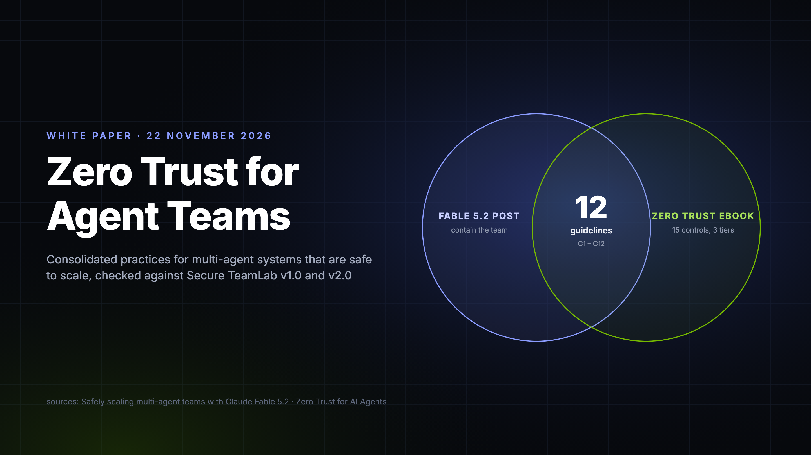
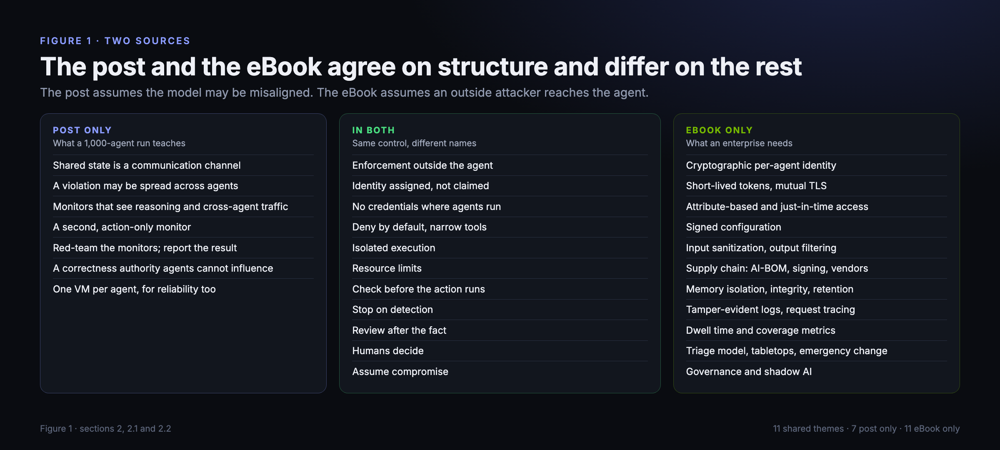
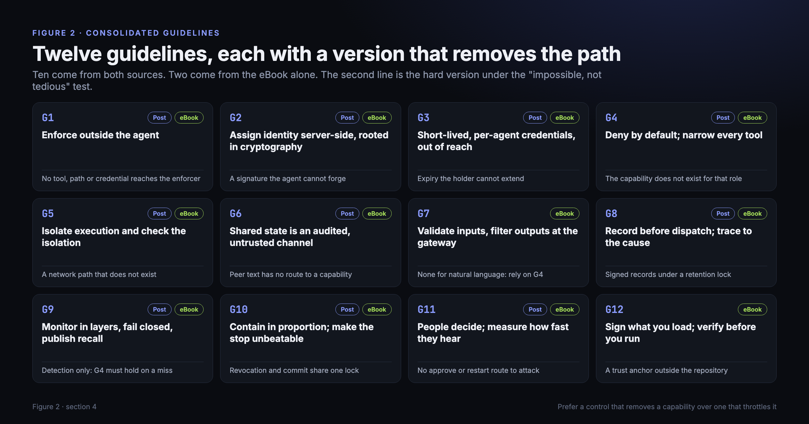
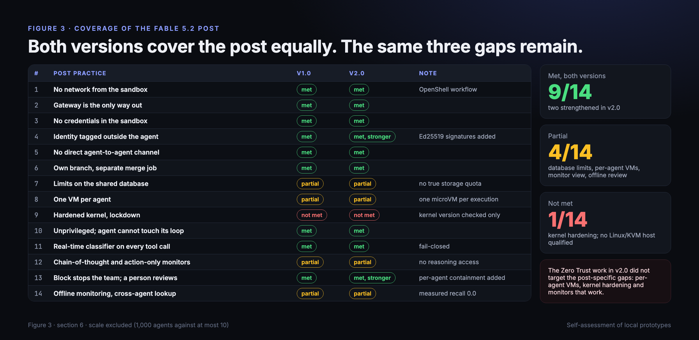
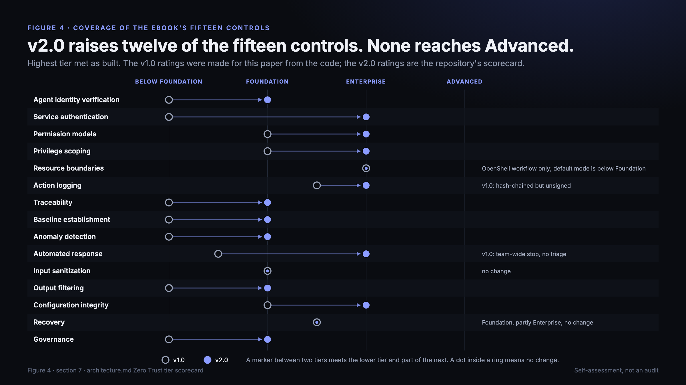
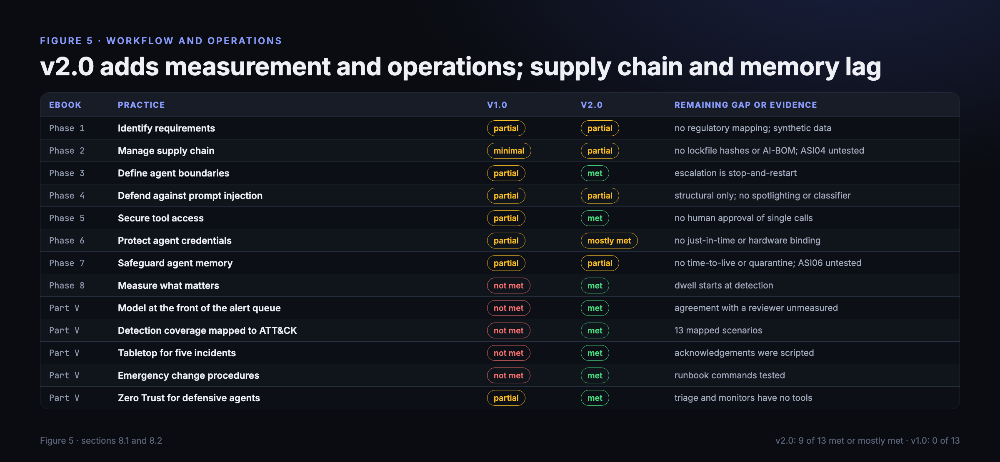
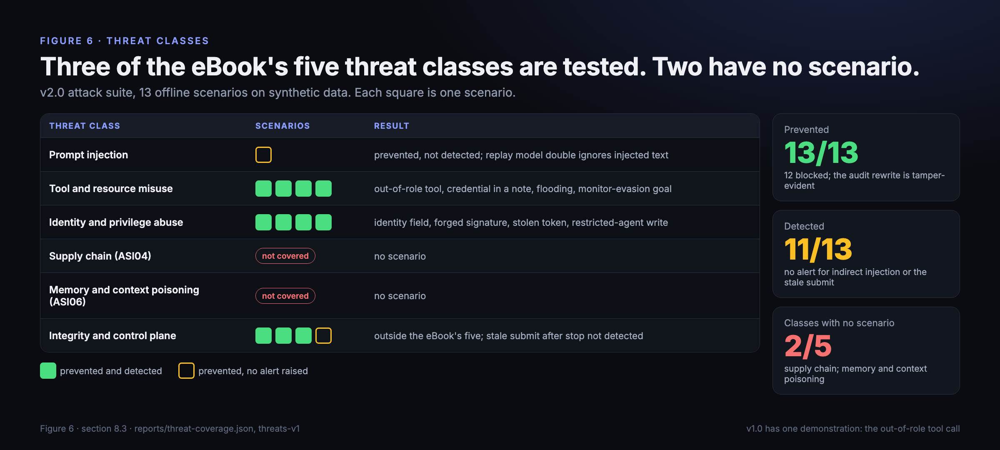
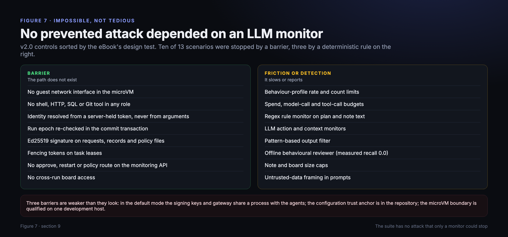

# Zero Trust for Agent Teams

*A consolidated set of practices for building multi-agent systems that are safe to scale, drawn from two Anthropic publications and checked against two reference implementations (Secure TeamLab v1.0 and v2.0).*

22 November 2026

---

## Executive summary

Anthropic has published two pieces of guidance that bear on the same problem from opposite directions.

- **The Fable 5.2 post** (*Safely scaling multi-agent teams with Claude Fable 5.2*, 9 November 2026) describes how a 1,000-agent team was contained while it reproduced a formal proof of Fermat's Last Theorem. It is an account of one harness: offline sandboxes, a gateway that owns identity, and two monitors. Its premise is that the model itself may be misaligned.
- **The eBook** (*Zero Trust for AI Agents*, in this repository as [docs/4e89a59711a145138bd8edbe7539331abc14ac0b.pdf](../4e89a59711a145138bd8edbe7539331abc14ac0b.pdf)) is a general enterprise framework: fifteen controls in three tiers (Foundation, Enterprise, Advanced), an eight-phase implementation workflow, and guidance for security operations. Its premise is that an outside attacker will compromise an agent.

The two overlap on the structural controls and differ on almost everything else. Both put enforcement outside the agent, deny by default, isolate execution, log before trusting, and monitor behaviour with the power to stop. The post adds what only a team run teaches: shared state is a communication channel, a violation may be spread across agents, and monitors need to see more than single actions. The eBook adds what only an enterprise needs: cryptographic identity, short-lived credentials, signed configuration, output filtering, supply-chain and memory controls, governance, and measured response times.

This paper merges them into **twelve guidelines** (section 4) and scores both implementations against each source (sections 6 to 8).

| | TeamLab v1.0 | TeamLab v2.0 (this repository) |
|---|---|---|
| Built to follow | The Fable 5.2 post | The post, plus the eBook's tiers |
| Post practices covered (of 14) | 9 met, 4 partial, 1 not | 9 met, 4 partial, 1 not; two of the met ones strengthened |
| eBook controls at Foundation or above (of 15) | 6, plus 2 met only in part (one workflow, or the mechanism without triage) | 14, plus resource boundaries for the OpenShell workflow only |
| eBook controls at Enterprise | 0 fully | 6, plus resource boundaries for the OpenShell workflow only |
| Mapped attack scenarios | 1 demonstration | 13 run: 13 prevented, 11 detected |
| Backend tests | 83 passed (14 November 2026) | 338 passed, 8 skipped, 2 expected failures (re-run for this paper) |

The v1.0 column for the eBook is my assessment for this paper, made by reading the v1.0 code against the tier tables. The v2.0 column is the repository's own scorecard in [architecture.md](../../architecture.md#zero-trust-tier-scorecard). Neither is an audit.

Three findings matter more than the counts:

1. **The deterministic controls carry the safety case in both versions.** The LLM behavioural reviewer scored 0.0 strict recall on its frozen suites and has not been re-measured. Everything that was prevented was prevented by a deterministic control: a capability that did not exist, a signature that did not verify, a transaction that re-checked the run epoch, or a fixed rule.
2. **v2.0 does not cover two of the eBook's five threat classes.** Nothing tests supply chain (OWASP ASI04) or memory and context poisoning (ASI06).
3. **The default mode is still one process.** Per-agent keys, short-lived tokens and containment protect the agent-to-gateway path. A compromise of the runtime process defeats all of them. Only the OpenShell workflow has a real isolation boundary, qualified on one macOS development host.

---

## 1. The two sources

### 1.1 The Fable 5.2 post

A lead agent and 999 helpers, each in its own VM, proved 54 of 60 statements, including the final theorem, in 28.7 hours. They were given a shell, a file editor, a Git branch each and a shared Postgres database. They built their own coordination on five tables.

The safety design has three layers, and the post states the reason for layering directly: "no single layer of defense is sufficient to contain a team of agents."

| Layer | What the post describes |
|---|---|
| **Sandboxing** | No network; the only outbound link is a pipe to a gateway. No credentials in the sandbox. No messaging tools: agents coordinate only through the database and Git. The gateway tags each request with the agent's identity from outside the sandbox. Agents push only to their own branch; a separate job merges. A shared unprivileged database role, a 5-second limit per statement, writes refused above 256 MiB. A hardened kernel in lockdown mode. Commands run unprivileged, and agents cannot read or modify the loop that runs them. |
| **Real-time monitoring** | A prompted LLM classifier checks every shell command and file edit before it runs. It targets sandbox escape, boundary probing, monitor tampering and harmful actions. The post describes a block stopping the whole team until a person reviews it; in this particular run, a block on a helper would have removed that helper and a block on the lead would have ended the run. In red-team evaluations, monitors that saw chain of thought and inter-agent communication caught every sabotage attempt. A second, action-only monitor runs in parallel so that persuasive reasoning cannot talk the monitor round. Only the action-only monitor was live in this run. |
| **Offline monitoring** | The same threat models applied to the run's records, kept outside the sandboxes, with the ability to look up other agents' actions. Serious findings go to the run's owners. |

Across more than a million tool calls, none was blocked.

The post also reports operational lessons that are not security controls but shape the design: a single shared machine failed at about 100 agents, agents misjudged difficulty and gave up early (helpers called 47 of 60 statements infeasible), and correctness was decided by Lean's checker, not by any agent.

### 1.2 The Zero Trust eBook

The eBook starts from three principles: never trust and always verify, assume breach, least privilege. It adds two ideas specific to agents:

- **Least agency** (an OWASP term): restrict what each tool can do, how often and where, not only what an identity can reach.
- **Impossible, not tedious**: a control whose value is friction (rate limits, extra hops, rotation of a static key) fails against an attacker with unlimited patience. Prefer controls that remove a capability.

Its content, in the order this paper uses it:

| Part | Content |
|---|---|
| II. Threats | Prompt injection, tool and resource misuse, identity and privilege abuse, supply chain, memory and context poisoning |
| III. Controls | Fifteen controls in seven groups, each with a Foundation, Enterprise and Advanced tier |
| IV. Workflow | Eight phases: requirements, supply chain, agent boundaries, prompt injection, tool access, credentials, memory, measurement |
| V. Operations | Triage model at the front of the alert queue, ATT&CK coverage mapping, a five-incident tabletop, emergency change procedures, Zero Trust applied to defensive agents |

The eBook raises the Foundation floor: cryptographic identity, short-lived tokens, identity-based isolation and automated first-pass triage are now entry requirements. A static API key with a rotation policy is "a known gap", not a Foundation posture.

---

## 2. Where the two sources overlap

The same control appears in both under different names. The post describes one instance; the eBook describes a ladder.

| Theme | Fable 5.2 post | eBook | Relationship |
|---|---|---|---|
| Enforcement outside the agent | Gateway outside the sandbox; agents cannot read or modify the agent loop | Controls enforced "outside the agent level, in case the agent or the agent environment is compromised" (Phase 5) | Same principle |
| Identity assigned, not claimed | Gateway tags identity from outside the sandbox to prevent impersonation | Agent identity verification; unique ID and own credentials per agent | Post gives the mechanism; eBook requires it to be cryptographic |
| No credentials where agents run | No API keys or credentials in the sandbox | Credential isolation; never in code or configuration; runtime injection | Same principle; eBook adds short lifetime |
| Deny by default, narrow tools | No network, no messaging tools, own branch only, unprivileged user | RBAC deny-by-default, tool allow-listing, capability restrictions, least agency | Same principle |
| Isolated execution | One offline VM per agent, hardened kernel | Resource boundaries: sandbox per agent (Enterprise), microVM and attestation (Advanced) | Post sits at the eBook's Enterprise-to-Advanced level |
| Resource limits | 5-second statements, 256 MiB write cap | Rate limits, spending controls, circuit breakers | Same control; eBook warns it is friction, not a barrier |
| Check before the action runs | Classifier on every tool call, before execution | Continuous authorization at each action (Advanced); parameter validation before execution | Same timing, different checker |
| Stop on detection | Block halts the team, or removes the agent | Automated response: session termination, credential revocation | Same control |
| Review after the fact | Offline monitor over run records | Immutable audit trails, traceability, behavioural monitoring | eBook specifies the log's integrity; post specifies what the reviewer looks for |
| Humans decide | A person reviews a block before the team resumes | "Automate the bookkeeping around incidents, not the decisions" | Same principle |
| Assume compromise | Monitoring assumes the model may be misaligned | Assume breach | Same posture, different adversary |

### 2.1 What only the post covers

| Practice | Why the eBook does not reach it |
|---|---|
| Shared state is a communication channel. Coordination goes only through an audited database and Git | The eBook treats inter-agent trust as delegation and identity, not as covert channels |
| A violation may be distributed across agents, so a block can stop the whole team | The eBook's automated response is per session or per credential |
| Monitors should see chain of thought and inter-agent communication, with a separate action-only monitor | The eBook's behavioural monitoring is statistical: baselines, thresholds, drift |
| Red-team the monitors with decomposition attacks and report the result | The eBook asks for ATT&CK coverage of detections, not adversarial evaluation of classifiers |
| An independent correctness authority (Lean's checker) that agents cannot influence | Outside the eBook's scope |
| One VM per agent as a reliability requirement, not only a security one | Outside the eBook's scope |
| Agents give up early and misjudge difficulty; human direction still helps | Outside the eBook's scope |

### 2.2 What only the eBook covers

| Practice | Why the post does not reach it |
|---|---|
| Cryptographic, per-agent identity and non-repudiation | A closed experiment trusts its own gateway |
| Short-lived tokens, mutual TLS, hardware-bound credentials | No services outside the harness to authenticate to |
| Attribute-based and just-in-time access | Roles were fixed: one lead, 999 helpers |
| Signed configuration and immutable infrastructure | Not discussed |
| Input sanitization, spotlighting, output filtering for sensitive data | The sandbox had no external input and no network to leak to |
| Supply chain: AI-BOM, dependency health, signing, vendor assessment | The image was built in-house with the toolchain included |
| Memory isolation, integrity and retention | Agents shared a database by design |
| Tamper-evident logs and request tracing | "Run records kept outside the sandboxes" is the extent of it |
| Dwell time and coverage as the first two metrics | Not discussed |
| First-pass triage by a model, tabletops, emergency change procedures | A research run has an owner, not a security operations team |
| Governance: acceptable use, approval of deployments, shadow AI | Outside the post's scope |

The two lists are complementary. The post is strongest where the eBook is thin (team dynamics, monitor design) and silent where the eBook is detailed (identity, integrity, operations).

---

## 3. One threat model from two

The post defends against the model. The eBook defends against an attacker who reaches the model. A team of agents needs both, and each threat below is addressed by a guideline in section 4.

| Threat | Source | Why teams make it worse | Guidelines |
|---|---|---|---|
| Sandbox escape, boundary probing | Post | A thousand agents probe a thousand times | G5 |
| Monitor or grader tampering | Post | The reward for success is large | G1, G8, G11 |
| Decomposition: a harmful goal split across agents or time | Post | No single action looks wrong | G8, G9 |
| Covert coordination through shared resources | Post | Any writable shared service is a message board | G6 |
| Prompt injection, direct and indirect | eBook | One poisoned input can be relayed by peers | G4, G7 |
| Tool misuse within granted permissions, tool chaining | eBook | Chains can cross agents | G4, G8 |
| Identity and privilege abuse, confused deputy, unscoped delegation | eBook | Delegation is routine in a team | G2, G3, G4 |
| Resource exhaustion and loop amplification | Both | Cost scales with headcount | G4, G9 |
| Supply chain: models, tools, dependencies | eBook | Every agent loads the same compromised component | G12 |
| Memory and context poisoning | eBook | Shared notes and boards persist across agents | G6, G7 |

---

## 4. Consolidated guidelines

Each guideline states the rule, where it comes from, what a hard version of it looks like under the eBook's "impossible, not tedious" test, and how the two implementations apply it.

### G1. Enforce outside the agent

**Rule.** Name the component that enforces each property. It must not be the model, the prompt, or middleware running in the agent's own process and under its control.

**Sources.** Post: gateway outside the sandbox; agents cannot reach harness code. eBook: Phase 5, enforce "outside the agent level"; Phase 3, "it's one thing to tell an agent 'Don't do this', it's another to prohibit that action through permissions."

**Hard version.** The agent has no tool, path or credential that reaches the enforcing component.

**In TeamLab.** Every effect goes through `Gateway.call`. A `Guard` middleware removes the framework's automatically added filesystem, planning and delegation tools. Agents have no tool that writes to the event store, the audit journal or the monitor configuration. Both versions. Limit: in the default mode the gateway and the agents share one Python process.

### G2. Assign identity server-side and root it in cryptography

**Rule.** The gateway decides who is calling. Identity never arrives in model-supplied arguments. Each agent has its own key, and its requests and audit records are signed.

**Sources.** Post: identity tagged from outside the sandbox. eBook: agent identity verification (Foundation requires cryptographic material, "not just labels"); Phase 3 and Phase 6.

**Hard version.** A signature the agent cannot forge, from a key the agent's sandbox does not hold. Hardware-backed at the Advanced tier.

**In TeamLab.** v1.0: a random bearer token per agent, held in a tool closure; identity fields in arguments stop the team. v2.0 adds a per-agent Ed25519 key, a signature on every request and audit record, and public keys in the evidence bundle. Limit: private keys live in the runtime process, so they prove attribution, not isolation.

### G3. Keep credentials short-lived, per agent and out of reach

**Rule.** No provider, cloud, Git or database secret is readable from where agent code runs. Tokens expire in minutes and refresh automatically. Each agent has its own. Services authenticate each other.

**Sources.** Post: no credentials in the sandbox. eBook: service authentication, Phase 6; static keys are "already-compromised".

**Hard version.** Expiry and revocation the holder cannot extend; credentials bound to hardware.

**In TeamLab.** v1.0: only the model proxy holds the provider key when the control plane is split; the OpenShell broker runs with model, database and AWS variables removed; agent tokens last for the run and die with the epoch. v2.0 adds 5-minute agent tokens with signed rotation, the provider key from the OS credential store, and mutual TLS 1.3 with pinned server keys between control-plane services. Limits: a key in `.env` still works with a warning; no certificate rotation or revocation list; plane services share one OS user by default.

### G4. Deny by default and narrow every tool

**Rule.** Give each role an explicit list of structured tools. Reject anything unlisted. Restrict what each tool can do and validate its parameters. Re-authorize at every step of a multi-agent workflow, not once at the start. Scope privileges to the task and shrink them when risk rises.

**Sources.** Post: no network, no messaging, own branch only, unprivileged user. eBook: permission models, privilege scoping, least agency, Phase 5, explicit trust boundaries in Phase 6.

**Hard version.** The capability does not exist for that role. A generic shell, HTTP or SQL tool is the opposite of this.

**In TeamLab.** Both versions: a `CAPABILITIES` table per role; no generic SQL, HTTP, shell or Git tool; an out-of-role call stops the team; task leases carry fencing tokens so that authority is scoped to one task and one claim. v2.0 adds a signed attribute-based policy keyed on action sensitivity and the agent's containment state, re-checked inside the dispatch transaction. Deliberately narrower than the post, which gave agents a shell. Limits: attributes are action class and agent state only; privileges never return to baseline within a run.

### G5. Isolate execution and check that the isolation is real

**Rule.** Model-written code runs only in a sandbox with no network interface, no credentials and no path to other sandboxes. Verify the policy, image and kernel before accepting a result. Qualify each host. State plainly which isolation a given run had.

**Sources.** Post: offline VM per agent, hardened kernel. eBook: resource boundaries (sandboxing is "table stakes for any agent handling untrusted input"); Phase 5 sandbox execution.

**Hard version.** A network path that does not exist. A deny rule on an existing interface is weaker than no interface.

**In TeamLab.** Both versions: one disposable NVIDIA OpenShell microVM per execution, digest-pinned image, no guest NIC, deny-all policy with Landlock required, guest kernel checked, sandbox always deleted, verification re-run in a second fresh sandbox. `qualify-host` passed on one macOS development host. v2.0 signs the sandbox policy file. Limits: the default trusted-tools mode has no isolation boundary at all (it runs no model-written code); isolation is per execution, not per agent; no Linux/KVM host is qualified; libkrun has no jailer equivalent.

### G6. Treat shared state as an audited, untrusted channel

**Rule.** Agents coordinate only through a store the gateway owns. Bound it in size, rate and time. Scope it to the run. Nothing an agent writes there can authorize work; only tasks issued by the controller can. Start recovered runs with clean model contexts.

**Sources.** Post: no messaging tools, coordination through database and Git, statement and write limits. eBook: Phase 7 memory isolation, integrity validation and retention; shared context poisoning in Part II.

**Hard version.** No cross-run memory exists; peer text has no route to a capability.

**In TeamLab.** Both versions: a run-scoped task board; notes capped at 2,000 characters and 256 per run and labelled untrusted; no cross-run reads or writes; restart creates a new run with new identities and clean contexts; checkpoints are hash-checked and results revalidated against the grader. Stricter than the post, whose agents designed their own tables with raw SQL. Limits: no time-to-live on notes within a run; no scenario tests poisoning (ASI06).

### G7. Validate inputs and filter outputs at the gateway

**Rule.** Treat every natural-language input as data. Enforce size and schema, delimit untrusted content, and filter known attack patterns. Scan what agents write for credentials and personal data before it is stored or exported.

**Sources.** eBook only: input sanitization, output filtering, Phase 4. The post avoided the problem by having no external input and no network.

**Hard version.** There is none for natural language, which is why this guideline cannot stand alone. Pattern filters are friction. The barrier is G4: injected text can ask for a tool that the role does not have.

**In TeamLab.** Both versions: 512 KB argument limit, untrusted-data framing in prompts, identity fields rejected. v2.0 adds a gateway output filter that stops a team writing a credential into a note, and redaction of credentials and emails on export. Limits: no injection pattern filter, spotlighting or encoded-payload detection; output filtering is pattern matching only.

### G8. Record before dispatch, in a log the agent cannot rewrite, and trace every action to its cause

**Rule.** Write the decision record before the action runs and pause if the write fails. Chain and sign records. Replicate them to append-only storage. Link every action to the request that caused it.

**Sources.** Post: run records kept outside the sandboxes. eBook: action logging, traceability, Phase 8 explainability.

**Hard version.** Signed records in storage with a retention lock held by a different principal.

**In TeamLab.** v1.0: a hash-chained, fsynced journal written before dispatch; an audit failure pauses the run; optional S3 Object Lock archive. v2.0 adds per-agent signatures on every record (`verify-audit` refuses unsigned records) and a trace tree per run with each operation parented to its cause. The attack suite shows why the signature matters: a rewritten record with a rebuilt hash chain still verifies as a chain, and only the signature check refuses it. Limits: Object Lock was checked against loopback MinIO only; no OpenTelemetry or SIEM export; tamper is found only when `verify-audit` runs.

### G9. Monitor in layers, fail closed, and publish the recall

**Rule.** Run a synchronous check on every action and an offline review of the whole record. Give monitors cross-agent context. Use more than one kind of monitor, and prefer a different model family from the workers. A timeout, an error or an invalid verdict pauses the run. Write down expected behaviour per role and alert on deviation. Measure recall against a frozen suite and report it, including when it is bad.

**Sources.** Post: real-time and offline monitors, chain-of-thought and action-only monitors, sabotage evaluations. eBook: baseline establishment, anomaly detection, Phase 8 behaviour.

**Hard version.** Monitors are detection, so by the eBook's test they are never the barrier. Capability removal (G4) must hold when the monitor misses.

**In TeamLab.** Both versions: a rule monitor, an action classifier and a team-context classifier before dispatch, all fail-closed; an offline reviewer over sliding windows with a cross-agent index that rejects findings without cited evidence; frozen development and holdout suites. v2.0 adds signed per-role behaviour profiles enforced as thresholds. **Measured recall of the offline reviewer: 0.0 on both suites**, with zero false positives. Limits: no chain-of-thought access; monitors use the same model family as the workers; profiles are hand-written and calibrated only on scripted and replay runs.

### G10. Contain in proportion, and make the stop unbeatable

**Rule.** Restrict, then quarantine, the one agent that deviates. Revoke its sessions and return its work. Stop the whole team for deterministic violations, because a violation may be distributed. Check the revocation inside the same transaction that commits an effect, so that a stale result cannot land. Recovery starts fresh agents under fresh authority.

**Sources.** Post: helper removed or team stopped; restart from the last save. eBook: automated response, recovery capabilities, circuit breakers.

**Hard version.** Revocation and commit share one lock. A stop that races a commit must win.

**In TeamLab.** v1.0: any block or capability violation stops the team by incrementing the run epoch, which is re-checked under the database lock at commit; restart creates a clean run. v2.0 adds graduated per-agent containment (active, restricted, quarantined; states only move down) with lease release, so the rest of the team continues. Limits: no un-quarantine; containing the coordinator, the verifier or a fixed-workflow worker pauses the run; strike thresholds are uncalibrated for live runs; a stale submit after a stop is refused but leaves no event.

### G11. Keep decisions with people and measure how fast they hear

**Rule.** Automate evidence collection and first-pass triage. Leave containment, restart and disclosure to an operator. Give defensive agents least privilege too. Keep the operator console read-only. Instrument dwell time and alert coverage first. Rehearse several incidents at once and agree emergency procedures beforehand.

**Sources.** Post: a person reviews a block; offline monitoring notifies run owners. eBook: automated response ("automate the bookkeeping around incidents, not the decisions"), Phase 8, Part V.

**Hard version.** The monitoring surface has no approve, restart or policy endpoint to attack.

**In TeamLab.** Both versions: a loopback, bearer-authenticated, read-only monitoring API and dashboard; stop and restart are CLI actions under the operator's OS permissions. v2.0 adds a tool-free triage step that writes a disposition for every alert and only recommends, operator-only acknowledgement, dwell and coverage metrics, a five-incident tabletop, and runbooks for incident response, emergency change and acceptable use. Limits: dwell is measured from detection, not occurrence; nothing pages anyone; the tabletop's acknowledgements were scripted.

### G12. Sign what you load and verify it before you run

**Rule.** Pin and verify images, tools, dependencies and policy files. Refuse to start on a failed check. Keep the trust anchor outside the repository it protects. Keep an inventory of model and tool provenance.

**Sources.** eBook only: configuration integrity, Phase 2 supply chain. The post built its toolchain into the image.

**Hard version.** Verification at start and at use, against a key the deployer of the code cannot replace.

**In TeamLab.** Both versions: a pinned dependency snapshot, a digest-pinned guest image, a pinned OpenShell version and a guest-kernel check. v2.0 signs the behaviour profiles, access policy and sandbox policy with Ed25519 and refuses to write a run row if any fails. Limits: the lockfile has no hashes; no AI-BOM, dependency scoring or vendor assessment; the signer list defaults to a file in the repository; signatures carry no version, so an older signed file is accepted.

---

## 5. The two implementations

Both are **Secure TeamLab**: a coordinator, up to eight analyst workers and a verifier that analyse a synthetic sales file through a gateway, a transactional task board, an independent SQL reference grader and, for authored code, disposable OpenShell microVMs. Both use LangChain Deep Agents for orchestration and treat the harness as untrusted.

| | v1.0 | v2.0 |
|---|---|---|
| Repository | [scaling_multi_agent_teams_v1.0](https://github.com/cwijayasundara/scaling_multi_agent_teams_v1.0) | This repository |
| Relationship | Baseline | v1.0 plus four steps of Zero Trust work: Foundation, measurement, Enterprise controls, evidence |
| Source modules in `src/teamlab` | 27 | 39 |
| Added in v2.0 | | `identity`, `access`, `containment`, `profiles`, `dlp`, `config_signing`, `plane_tls`, `tracing`, `triage`, `metrics`, `attack_suite`, `tabletop`; three signed policy files; a threat catalogue; four runbooks |
| Unchanged core | | Gateway order of checks, run epochs, leases and fences, OpenShell broker, monitors, offline reviewer, grader, recovery |

v2.0 kept the v1.0 architecture and added controls at the gateway. Nothing in v1.0 was removed. One behaviour changed: in v1.0 every block or violation stops the whole team, and v2.0 contains a single agent for profile breaches, denied writes by a restricted agent and rejected credentials, keeping the team-wide stop for deterministic violations.

---

## 6. Coverage of the Fable 5.2 post

"Met" means the practice is implemented and tested. "Partial" means it is implemented in a narrower form or for one workflow. Scale is excluded: the post ran 1,000 agents and TeamLab runs at most ten.

| # | Post practice | v1.0 | v2.0 | Notes |
|---|---|---|---|---|
| 1 | No network from the sandbox | Met (OpenShell) | Met (OpenShell) | No guest NIC; egress and DNS checks in `host-qualification.json` |
| 2 | Gateway is the only way out | Met | Met | Single `Gateway.call` path |
| 3 | No credentials in the sandbox | Met | Met | Broker environment scrubbed; model proxy holds the key |
| 4 | Identity tagged outside the agent | Met | Met, stronger | v2.0 adds Ed25519 signatures |
| 5 | No direct agent-to-agent channel | Met | Met | Board rows only |
| 6 | Own branch, separate merge job | Met | Met | Controller-owned Git, merged only after verification |
| 7 | Limits on the shared database | Partial | Partial | Board and note caps; Postgres 5-second timeouts; no true storage quota |
| 8 | One VM per agent | Partial | Partial | One microVM per execution; agent runtimes share a process |
| 9 | Hardened kernel, lockdown | Not met | Not met | Guest kernel version is checked, not hardened; no Linux/KVM host qualified |
| 10 | Unprivileged execution; agent cannot touch its loop | Met | Met | UID 1000, `no_new_privs`, rlimits; framework tools removed |
| 11 | Real-time classifier on every tool call | Met | Met | Rules plus two LLM monitors, fail-closed; live mode only for the LLM monitors |
| 12 | Monitor with chain-of-thought and cross-agent view, plus action-only monitor | Partial | Partial | Action and team-context monitors; no reasoning access; same model family |
| 13 | Block stops the team; a person reviews | Met | Met, refined | v2.0 contains one agent for profile breaches and keeps the team stop for deterministic violations |
| 14 | Offline monitoring with cross-agent lookup | Partial | Partial | Implemented with evidence-cited findings; measured recall 0.0 |

The post-specific gaps are the same in both versions: per-agent VMs, kernel hardening, and monitors that work. v2.0's Zero Trust work did not target them.

---

## 7. Coverage of the eBook's fifteen controls

Tiers are the highest tier met as built. "Below" means below Foundation.

| eBook control | v1.0 | v2.0 | What changed |
|---|---|---|---|
| Agent identity verification | Below: random per-agent tokens, no cryptographic identity | Foundation | Per-agent Ed25519 keys; signed requests and records |
| Service authentication | Below: run-length tokens; provider key in `.env`; plane uses peer-UID and a service token | Enterprise | 5-minute tokens with signed rotation; OS credential store; mutual TLS with pinned keys |
| Permission models | Foundation: role capabilities, deny by default | Enterprise | Signed attribute-based policy on action sensitivity and agent state |
| Privilege scoping | Foundation: static roles; task-scoped leases and fences | Enterprise | Per-agent restriction and quarantine |
| Resource boundaries | Enterprise for OpenShell only; below for the default mode | Same | Sandbox policy file is now signed |
| Action logging | Foundation, partly Enterprise: hash-chained journal, optional Object Lock, unsigned | Enterprise | Records signed and signature-checked |
| Traceability | Below: operation ids and run ids, no causal chain | Foundation | Trace tree per run; parent id inside the signed request |
| Baseline establishment | Below: budgets and limits only | Foundation | Signed per-role behaviour profiles |
| Anomaly detection | Below: monitors alert, but no first-pass triage | Foundation | Triage on every alert; dwell and coverage measured |
| Automated response | Partial: automatic team-wide stop and revocation, no triage context | Enterprise | Graduated per-agent containment; structured dispositions |
| Input sanitization | Foundation | Foundation | No change |
| Output filtering | Below: wording rules on notes only | Foundation | Credential filter at the gateway; redaction on export |
| Configuration integrity | Foundation: version-controlled | Enterprise | Signed files verified before a run row is written |
| Recovery | Foundation, partly Enterprise | Same | No change |
| Governance | Below: `SECURITY.md` only | Foundation | Acceptable use, incident response, emergency change, tabletop |

No control reaches Advanced in either version. The v2.0 scorecard, with the tests behind each row, is in [architecture.md](../../architecture.md#zero-trust-tier-scorecard).

---

## 8. Coverage of the eBook's workflow and operations

### 8.1 Part IV: the eight phases

| Phase | v1.0 | v2.0 | Evidence and gap |
|---|---|---|---|
| 1. Identify requirements | Partial | Partial | A PRD template and a research approach document. No regulatory mapping; data is synthetic |
| 2. Manage supply chain | Minimal | Partial | Pinned versions, digest-pinned image, pinned OpenShell; v2.0 signs policy files. No lockfile hashes, AI-BOM, dependency scoring, reachability analysis or vendor assessment. **ASI04 untested** |
| 3. Define agent boundaries | Partial | Met | Roles, capability table and blast-radius statement in both. v2.0 adds cryptographic identity. Escalation is stop-and-restart, not per-action approval |
| 4. Defend against prompt injection | Partial | Partial | Structural defence in both: injected text cannot unlock a tool, and the attack surface is a local CLI. No spotlighting or classifier. The v2.0 injection scenario runs on a model double that ignores injected text |
| 5. Secure tool access | Partial | Met | Allow-listing, capability restrictions, argument checks, sandbox and budgets in both. v2.0 authenticates each call with a short-lived token bound to the agent's key. No human approval step for individual calls |
| 6. Protect agent credentials | Partial | Mostly met | v1.0 has isolation only. v2.0 has short lifetime, per-agent keys, per-step authorization and limited ABAC. No just-in-time elevation, no hardware binding, no certificate lifecycle |
| 7. Safeguard agent memory | Partial | Partial | Run-scoped board, bounded notes, clean contexts on restart, hash-checked checkpoints. No per-item source tags, time-to-live or quarantine. **ASI06 untested** |
| 8. Measure what matters | Not met | Met | v2.0 measures dwell and coverage, exports a trace, and enforces behaviour profiles. Dwell starts at detection |

### 8.2 Part V: defensive operations

| Practice | v1.0 | v2.0 | Evidence and gap |
|---|---|---|---|
| A model at the front of the alert queue | No | Yes | `teamlab triage`: rule mapping by default, a tool-free strict-schema model call with `--model`. Agreement with a human reviewer has not been measured |
| Detection coverage mapped to ATT&CK | No | Yes | 13 scenarios mapped to OWASP Agentic Top 10 and MITRE ATLAS or ATT&CK where a mapping could be confirmed |
| Tabletop for five simultaneous incidents | No | Yes | `teamlab tabletop`: 5 incidents, 11 alerts, triage and human coverage 1.0, median dwell about 1 s with a scripted acknowledgement |
| Emergency change procedures agreed in advance | No | Yes | [emergency-change.md](../runbooks/emergency-change.md), with commands checked by a test |
| Zero Trust for defensive agents | Partial | Yes | Monitors and triage have no tools and cannot change run state; the dashboard is read-only; acknowledgement has no API route |

### 8.3 Part II: the five threat classes

Measured by the v2.0 attack suite ([reports/threat-coverage.md](../../reports/threat-coverage.md)). v1.0 has one demonstration, the out-of-role tool call.

| Threat class | Scenarios in v2.0 | Result |
|---|---|---|
| Prompt injection | 1 | Prevented, **not detected**. Shows the gateway path stays in scope, not that a live model resists injection |
| Tool and resource misuse | 4 (out-of-role tool, credential in a note, tool flooding, monitor-evasion goal) | All prevented and detected |
| Identity and privilege abuse | 4 (identity field in arguments, forged signature, stolen token, restricted-agent escalation) | All prevented and detected |
| Supply chain | 0 | **Not covered** |
| Memory and context poisoning | 0 | **Not covered** |
| Integrity and control plane (outside the eBook's five) | 4 (tampered policy, rewritten audit record, stale result after stop, foreign-CA client) | All prevented; stale result after stop **not detected**; the audit rewrite is tamper-evident, not blocked |

Total: 13 run, 13 prevented, 11 detected, 8 triaged (every scenario that raised an alert).

---

## 9. Which controls are barriers and which are friction

The eBook's design test asks whether a control makes an attack impossible or only tedious. Applied to v2.0:

| Barrier: the path does not exist | Friction or detection: it slows or reports |
|---|---|
| No guest network interface in the microVM | Behaviour-profile rate and count limits |
| No tool for shell, HTTP, SQL or Git in any role | Spend, model-call and tool-call budgets |
| Identity resolved from a server-held token, never from arguments | Regex rule monitor on plan and note text |
| Run epoch re-checked in the commit transaction | LLM action and context monitors |
| Ed25519 signature on requests, records and policy files | Pattern-based output filter |
| Fencing tokens on task leases | Offline behavioural reviewer |
| No approve, restart or policy route on the monitoring API | Note and board size caps |
| No cross-run board access | Untrusted-data framing in prompts |

Ten of the 13 prevented scenarios were prevented by something in the left column. The other three were stopped by a deterministic rule in the right column: tool flooding by a profile limit, the credential in a note by the output filter, and the monitor-evasion goal by the regex rule monitor. Nothing in the evidence depends on an LLM monitor catching intent. That is the right way round, and it is also why the monitoring result (0.0 recall) has not yet cost anything: the suite does not contain an attack that only a monitor could stop.

Three items in the left column are weaker than they look. In the default mode the signing keys and the gateway share a process with the agents. The configuration trust anchor is in the repository. The microVM boundary is qualified on one development host with an experimental driver.

---

## 10. Gaps, in priority order

1. **Make the isolation boundary the default.** Move authorization, keys and the coordination database out of the agent runtime onto distinct OS users, and qualify OpenShell on Linux/KVM. Until then, G2 and G3 are attribution controls. (Post practices 8 and 9; eBook resource boundaries.)
2. **Get monitors to non-zero recall.** Use a different model family, longer cross-agent context and action records in the test cases, then re-measure. Add scenarios that only a monitor can catch, such as a decomposition attack within granted capabilities. (Post practices 12 and 14; G9.)
3. **Cover the two missing threat classes.** A supply-chain scenario (a tampered image digest or dependency) and a poisoning scenario (a note planted for a later agent or round). Add lockfile hashes and an inventory of model and tool provenance. (eBook Phases 2 and 7.)
4. **Close the integrity loopholes.** Move the signer list out of the repository, add a version to signed files to stop rollback, and add certificate rotation and revocation. (G12, G3.)
5. **Detect what is only prevented.** Record an event for a stale submit after a stop, and raise an alert when injected instruction patterns reach an agent. Add spotlighting and an injection pre-filter. (G7.)
6. **Complete a live run.** A 1-worker live collaborative run has not finished. Calibrate profile and containment thresholds on live runs before scaling. (G9, G10.)
7. **Measure the human.** Start dwell at occurrence, add a notification channel, and export traces and alerts to an external store. Measure triage agreement with a reviewer. (G11.)

---

## 11. How to use this paper

For a team starting a multi-agent build:

1. Build G1, G4 and G10 first. A single gateway, a capability table and a transactional kill switch need no cryptography and prevented most of what was tested here.
2. Add G5 before any model-written code runs, and G6 before agents share anything.
3. Add G2, G3, G8 and G12 to reach the eBook's raised Foundation floor.
4. Add G9 and G11 last and measure them. Do not count a monitor as a control until it has a recall number.
5. Apply the barrier-or-friction table (section 9) to your own design at every review.

---

## A note on evidence

Both implementations are small local prototypes on synthetic data, not reproductions of the post's results and not certified against the eBook. Replay runs use real Deep Agents graphs with a deterministic model double. Live calls used `gpt-6-luna` under spend caps, and no live collaborative run completed. OpenShell checks passed on one macOS development host. The Object Lock path was checked against loopback MinIO. Tier ratings are self-assessments; the v1.0 ratings were made for this paper from the code. The post was read as published on 22 November 2026, and its run metrics are the authors' own. The v2.0 backend suite was re-run for this paper: 338 passed, 8 skipped, 2 expected failures that record the two detection gaps. Other figures are taken from the reports in `reports/` as dated there.

## Sources

- Anthropic, *Safely scaling multi-agent teams with Claude Fable 5.2*, 9 November 2026. https://claude.dev/blog/safely-scaling-multi-agent-teams-with-fable-5-2/
- Anthropic, *Zero Trust for AI Agents* (eBook). [docs/4e89a59711a145138bd8edbe7539331abc14ac0b.pdf](../4e89a59711a145138bd8edbe7539331abc14ac0b.pdf)
- Secure TeamLab v1.0. https://github.com/cwijayasundara/scaling_multi_agent_teams_v1.0
- Secure TeamLab v2.0 (this repository): [architecture.md](../../architecture.md), [SECURITY.md](../../SECURITY.md), [reports/IMPLEMENTATION_STATUS.md](../../reports/IMPLEMENTATION_STATUS.md), [reports/threat-coverage.md](../../reports/threat-coverage.md), [whitepaper.md](whitepaper.md)
- OWASP GenAI Security Project, *OWASP Top 10 for Agentic Applications*, 9 December 2025.
- MITRE ATLAS and MITRE ATT&CK, as mapped in `src/teamlab/threats.json`.
- NIST SP 800-207, *Zero Trust Architecture*, 2020.
